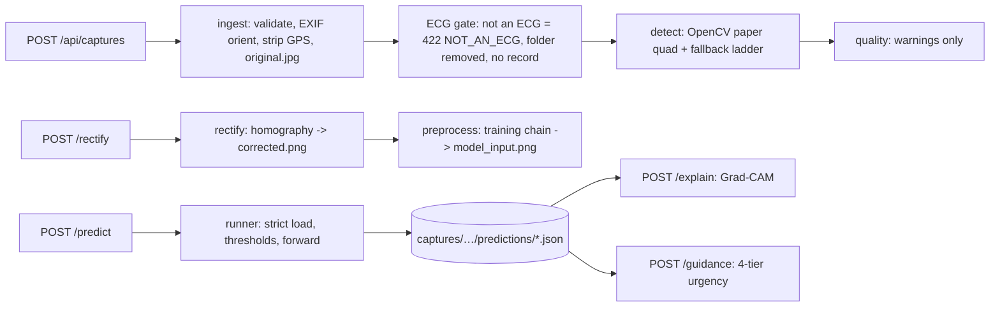

# Repository Guidelines

Last verified against the tree: **2026-10-16**.

> This is the local JSON-storage variant of `../cardiosentry-application/` (the PostgreSQL build), kept for presentation hosting; its on-disk format is the one the PostgreSQL build's `scripts/import_filesystem.py` imports.

## Project Overview

CardioSentry serves trained 12-lead ECG multi-label classifiers to a phone on the LAN. You photograph a printed ECG sheet, and the backend detects the paper, rectifies it, rebuilds the exact training input, and runs the model. It can also explain the result with Grad-CAM and give a four-tier clinical-urgency guidance read. It is a research/validation tool. Its single-process FastAPI server serves both `/api` and the built React PWA.

Read these before re-deriving anything from source:

- `README.md`: stages, layout, persistence, security and the non-negotiables (§The non-negotiables). Trust the tree if a model listing drifts.
- `models/README.md`: descriptor format and the 7-step "add a model" checklist.
- `backend/arch/README.md`: vendoring provenance and the only 3 allowed deviations.
- `docs/clinical-guidance.md`: guidance tiers and rules.
- `../CARDIOSENTRY_WEB_APP_PLAN.md`: the spec that `(plan §n.n)` comments cite. Grep a heading. Don't read all 1105 lines.

## Architecture & Data Flow



- **Stages are separate HTTP calls**: upload, then rectify, then predict. The user can fix corners in `CornerEditScreen`/`QuadEditor` between upload and rectify.
- **Lifespan** (`backend/main.py`): `create_state()` (ensure dirs → load `accounts.json` → create `admin`/`admin` only if the permanent `admin` account id is missing (WARNING log) → construct the record store) → discover and validate `models/*.yaml` → load the active model → warm-up forward → load + warm up the ECG gate (`models/gates/<CARDIOSENTRY_ECG_GATE>.yaml`; fails startup if broken) → **warn-only** self-check against `tests/fixtures/corpus_sheet.jpg` → disk check → print LAN URL + QR → mount `frontend/dist/`. Nothing to close at shutdown.
- **State/DI**: there is no `fastapi.Depends`. An `AppState` dataclass lives on `app.state.csd`, and routes call `st = get_state(request)` (`backend/api/state.py`). Lazy model loads take `AppState._load_lock`.
- **Concurrency**: route handlers are sync `def` and run in Starlette's threadpool, except `create_capture`, which awaits `file.read()` and runs the ECG gate via `run_in_threadpool`. The async `auth_gate` middleware dispatches `AccountStore.user_for_token` with `run_in_threadpool`; never block its event loop on file I/O. Every forward runs under `with lm.lock:` (`services/runner.py`) or the learned gate's own `LoadedGate.lock`; the OCR gate runs its Tesseract passes as parallel subprocesses (`OMP_THREAD_LIMIT=1`) on its own 4-thread pool. `RecordStore` holds one in-process `threading.RLock` around capture.json read-modify-write, so the server must stay a single process (workers=1) and `scripts/reprocess.py` must run with the server stopped. Keep new handlers sync unless they must await.
- **Model is data, not code**: a descriptor `models/<id>.yaml` names an `arch.<pkg>` module, the weights, labels, thresholds, preprocess geometry, explain layer and verify block. Swapping models means repointing the `models/active.yaml` symlink. If a swap seems to need Python edits, that is the bug.
- **Persistence**: JSON files under `settings.data_dir` (default `captures/`), written atomically via `storage.atomic_write_json` (temp file + `os.replace`). `create_state()` = ensure_dirs → `AccountStore(data_dir / "accounts.json")` → ensure_admin → `RecordStore()`; the lifespan has nothing to close.

  ```
  captures/accounts.json
  captures/YYYY-MM-DD/YYYY-MM-DD_HHMMSS_xxxxxx/
    capture.json original.jpg preview.jpg overlay.jpg corrected.png model_input.png
    predictions/<run_id>.json
    explain/xai_<ts>_<method>_<model_id>/{record.json, <method>_<LABEL>_{heatmap,overlay}.png, raw.npz (optional)}
  ```
  `owner_of(record)` uses the immutable account id in `record.owner`, falling back to the permanent `admin` id for missing/null owners. Listing scans every capture.json, filters by owner, then pages. DELETE moves the whole capture folder (records included) to `captures/_trash/<date>/<id>/`; nothing is unlinked. Deleting an explain run removes its folder.
- **Frontend** holds no model knowledge. Labels, thresholds, guidance config and the privacy-notice version all come from `GET /api/config`. `screens/AuthScreen.tsx` handles sign in/register; the navbar **Settings** button (or mobile hamburger menu) opens `#/settings` (`screens/AccountScreen.tsx`) to edit the username/password and sign out. The topbar username is plain display text; Sign out lives inside Settings. Both auth and account share `components/PasswordInput.tsx`.

## Key Directories

| Path | Purpose |
|---|---|
| `backend/api/` | Thin routers. One file per area: `auth`, `captures`, `explain` (also owns `GET /api/models/{id}/layers`), `guidance`, `models`, `config`, `health`; `state.py` holds the singletons |
| `backend/services/` | All the real work: `records`, `accounts`, `ingest`, `ecg_gate` (+ `ecg_gate_ocr`), `detect`, `rectify`, `preprocess`, `quality`, `registry`, `runner`, `explain`, `guidance`, `storage` |
| `backend/services/records.py` | `RecordStore()`: capture/prediction/explain JSON files, owner-filtered listing, RLock-serialised capture.json updates, trash moves |
| `backend/services/accounts.py` | `accounts.json` users/sessions, salted PBKDF2-SHA256 (600k), 30-day sessions, immutable account ids, startup admin creation and `owner_of`. Rename preserves sessions; password change revokes the user's other sessions. Corrupt file refuses startup |
| `backend/services/storage.py` | Image/binary directories, id regexes, file-serving whitelists, `atomic_write_json` and trash moves |
| `backend/services/ecg_gate.py` | ECG / not-ECG gate run on every upload before detect: `load_gate` dispatches on descriptor `kind`; learned ConvNeXt gate. Reject = `422 NOT_AN_ECG`, folder removed, no `capture.json`; accepted verdict stored as `record.ecg_gate` |
| `backend/services/ecg_gate_ocr.py` | Default OCR lead-label gate (`ocr_lead_labels_v1`): parallel `tesseract` subprocesses looking for printed lead labels |
| `backend/schemas/` | Pydantic v2 request/response and stored record shapes; `model_descriptor.py`, `ecg_gate.py` (gate descriptor + `record.ecg_gate`) |
| `backend/arch/<pkg>/` | Vendored training-time `nn.Module` code, byte-identical except for 3 documented deviations |
| `models/` | `<id>.yaml` descriptors, the `active.yaml` symlink, `gates/<id>.yaml` ECG gate descriptors (not diagnostic models; `CARDIOSENTRY_ECG_GATE`), `weights/` (gitignored) |
| `frontend/src/` | `App.tsx` (hash router), `AppContext.ts`, `screens/`, `components/`, `api/{client,types}.ts`, `styles.css` (Tailwind entry), `ui.ts` (shared utility strings) |
| `scripts/` | `verify_model.py`, `reprocess.py`, `export_dataset.py`, `make_cert.sh` |
| `tests/` | pytest suite, `make_fixtures.py`, checked-in `fixtures/` |
| `captures/` | Runtime PHI: images, binary arrays, record JSON and `accounts.json` (credential/session hashes). Gitignored. Never commit it or write test output there |
| `docs/` | `clinical-guidance.md`, `system-flowchart/` (HTML source → PDF/PNG) |

### API surface — accounts and ownership

| Method & path | Router | Session |
|---|---|---|
| `POST /api/auth/register` | `auth.py` | Public; creates the account and signs in (`201 {"username"}`) |
| `POST /api/auth/login` | `auth.py` | Public; signs in (`200 {"username"}`) |
| `POST /api/auth/logout` | `auth.py` | Public; revokes the session and clears the cookie (`200 {"logged_out": true}`) |
| `GET /api/auth/me` | `auth.py` | Required; returns `{"username"}` |
| `PATCH /api/auth/account` | `auth.py` | Required; changes username and/or password with `current_password`; returns `{"username"}` |

`main.py`'s `auth_gate` returns `401 AUTH_REQUIRED` without a valid session on every `/api/*` path except health, config, login, register and logout. The optional `CARDIOSENTRY_APP_TOKEN` gate still applies in addition. All capture routes (including files, guidance and explain) are owner-scoped; another user's capture returns `404 CAPTURE_NOT_FOUND`. Listing filters by owner before paging; admin has no access to other users' captures.

Explain metadata comes from `GET /api/captures/{id}/explain/{xid}`; `GET …/explain/{xid}/files/record.json` now returns `404 UNKNOWN_FILE`. Only attribution PNGs and optional `raw.npz` are file-served.

## Development Commands

There is **no virtualenv and no `python` binary**. Use system `python3` and run from this directory. No database or container is needed.

```bash
python3 -m backend.main                          # serve on 0.0.0.0:8000, prints LAN URL + QR
cd frontend && npm run dev                       # Vite dev server, proxies /api -> 127.0.0.1:8000
cd frontend && npm run build                     # tsc --noEmit && vite build -> frontend/dist/ (served by backend)
python3 -m pytest -q                             # full suite, real CPU model, takes minutes
python3 scripts/verify_model.py [--model <id>]   # strict load + score drift vs descriptor verify block; exit 1 on drift
python3 scripts/reprocess.py --all --model <id> [--force|--dry-run]   # re-score stored captures
python3 scripts/export_dataset.py --out captures_export.csv
./scripts/make_cert.sh                           # mkcert -> certs/{key,cert}.pem (HTTPS for phone camera + PWA)
```

For HTTPS, run `uvicorn backend.main:app --host 0.0.0.0 --port 8000 --ssl-keyfile certs/key.pem --ssl-certfile certs/cert.pem`. TLS is not a setting.

To check that the app boots without starting a server:

```python
from fastapi.testclient import TestClient
from backend.main import app
with TestClient(app) as c: print(c.get("/api/health").json())
```

A healthy boot logs `verify_model self-check passed: max |Δ| = …`. The check only warns, so read the log.

There is **no lint or format tooling**: no ruff, black, mypy, ESLint or Prettier. `tsc` strict mode in `npm run build` is the only static gate.

## Code Conventions & Common Patterns

- **Python**: every module starts with `from __future__ import annotations`. Use full type hints and `logging.getLogger("cardiosentry.<area>")`. Cite the spec in comments as `(plan §n.n)`.
- **Errors**: raise `ApiError(status_code, code, message)` or `NotFound` from `backend/errors.py`. Handlers in `main.py` serialize them to `{"code", "message"}`. Codes are stable UPPER_SNAKE (`CAPTURE_NOT_FOUND`, `INFERENCE_FAILED`, `STORAGE_FULL`, `GUIDANCE_UNSUPPORTED_MODEL`). When you add a code, also map it in `frontend/src/api/client.ts`.
- **Schemas**: Pydantic v2 only (`model_validate`, `model_dump(mode="json")`). Name them `XxxRequest` / `XxxResponse` / `XxxSummary` / `XxxRecord`.
- **Settings**: all config lives in `backend/settings.py` (pydantic-settings, prefix `CARDIOSENTRY_`, reads `./.env`). Keep `.env.example` in sync, because it is the documentation. Preprocess and verify values in settings are **fallbacks**: the active descriptor wins. Per-model thresholds, labels and geometry go in `models/<id>.yaml`, never in `settings.py`.
- **Storage**: records go through `RecordStore`/`AccountStore`, which write with `atomic_write_json`; never write record JSON ad hoc. DELETE moves the capture folder to `captures/_trash/`, never unlinks it. Ids and served filenames are regex/whitelist-gated (`CAPTURE_ID_RE`, `FILE_WHITELIST`, `EXPLAIN_ID_RE`, `EXPLAIN_FILE_RE`). A new stage file 404s until it is whitelisted; explain `record.json` is deliberately not served.
- **Account ownership**: use `api/auth.py`'s `owned_capture` to return the folder and owner-scoped record; it compares `owner_of(record)` against `current_account(request).account_id`, never `.username`. Account ids are never reused and stay reserved names after a rename; `ADMIN_ACCOUNT_ID` is the permanent `admin` id, not a superuser role.
- **Session cookie**: `cardiosentry_session` is HttpOnly, SameSite=Lax and valid for 30 days. It is deliberately **not Secure over plain HTTP** (LAN/TestClient); it is Secure only over HTTPS. Do not set Secure unconditionally.
- **Geometry**: `input_size` and `views` are `[height, width]` (torch order), not PIL `(w, h)`. If you transpose them, the model still scores, but the results are silently wrong.
- **Frontend**: React 18 + TS strict. The hash router in `App.tsx` replaces react-router. Shared state uses `AppContext` + hooks (no Redux/Zustand). Every call goes through the `api` object in `api/client.ts`; uploads use XHR to get progress. Styling is Tailwind CSS v4 via `@tailwindcss/vite`: `src/styles.css` is the Tailwind entry with `@theme` tokens, base element styles and global print rules; utilities live inline in TSX, and shared class strings in `src/ui.ts` are complete literals (no clsx or fragment-built class names). Custom breakpoints are `tiny`, `phone`, `compact`, `nav`, `narrow`, `md` and `wide`; use these rather than default breakpoint names. The only typeface is Roboto, self-hosted by the npm package `@fontsource/roboto` (imported in `main.tsx`; the app must make no outbound calls, so never use a CDN font). The layout is a flex column: `<main>` grows (`flex-[1_0_auto]`) so the footer (Data Privacy Notice link) rests at the bottom of the viewport. The PWA comes from `vite-plugin-pwa`.

### Change-together table

| Change | Touch |
|---|---|
| API route | `backend/api/<mod>.py` + `backend/schemas/` + `frontend/src/api/{client,types}.ts` + `tests/test_api_smoke.py` |
| Auth/ownership | `services/{accounts,records}.py` + `api/auth.py` + `main.py` `auth_gate` + `schemas/{auth,capture}.py` + `owned_capture` callers (`api/captures.py`, `api/explain.py`, `api/guidance.py`) + `frontend/src/{App.tsx,api/{client,types}.ts,screens/{AuthScreen,AccountScreen}.tsx,components/PasswordInput.tsx}` + `frontend/src/components/PrivacyNotice.tsx` / `api/config.py` notice version + `tests/{conftest,test_accounts,test_api_smoke}.py` |
| Input chain | `services/preprocess.py` + `tests/test_preprocess_parity.py` (1e-6 parity vs training) |
| Stage output file | `services/storage.py` `FILE_WHITELIST` + `api/captures.py` + frontend |
| Explain | `services/explain.py` + `api/explain.py` + `schemas/explain.py` + `tests/test_explain.py` |
| Guidance rules | `services/guidance.py` (`RULE_SETS`, `FINDING_RULES`, `COMBINATIONS`; 911/CPR/AED, pediatric/pacemaker floors, known-history baselines, benign pair) + `schemas/guidance.py` (`cautions`, `combination_notes`, `priority_question`, `scope_note`) + `frontend/src/api/types.ts` + `frontend/src/components/GuidancePanel.tsx` utilities (including `print:` variants: screen-only priority gate, printable result/cautions/clinician notes/scope) / `frontend/src/styles.css` global print rules + `docs/clinical-guidance.md` + `tests/test_guidance.py` |
| Descriptor field | `schemas/model_descriptor.py` + affected `models/*.yaml` + `models/README.md` |
| ECG gate | `services/ecg_gate.py` (`load_gate` dispatch on descriptor `kind`, learned gate) + `services/ecg_gate_ocr.py` (OCR lead-label gate) + `schemas/ecg_gate.py` + `models/gates/*.yaml` + `api/captures.py` `create_capture` + `models/README.md` §ECG gate + `tests/test_ecg_gate.py`; switch gates with `CARDIOSENTRY_ECG_GATE=<id>` only; disabling it falsifies the privacy notice's "non-ECG photos are not stored" |
| Setting | `settings.py` + `.env.example` |
| Backend data handling | `frontend/src/components/PrivacyNotice.tsx` + bump `PRIVACY_NOTICE_VERSION` in `api/config.py` |
| New model | follow `models/README.md` checklist; fixture `tests/fixtures/expected_scores_<id>.json` + `EXPECTED_SCORES` in `tests/make_fixtures.py` |

## Important Files

- `backend/main.py`: app, lifespan, exception handlers, `auth_gate`, optional token gate, static mount, `main()`.
- `backend/api/state.py`: `AppState`, `create_state`, `get_state`.
- `backend/services/records.py`: JSON capture/prediction/explain records, ownership filtering, lock-serialised mutations, trash moves.
- `backend/services/accounts.py`: `accounts.json` credential/session store, PBKDF2-SHA256 (600k), startup admin creation, permanent `account_id` / `owner_of` rules.
- `backend/api/auth.py`: five auth routes, `current_account`, `owned_capture`, exact public-path allowlist.
- `backend/services/runner.py`: builds the arch, `load_state_dict(strict=True)`, threshold source, F2/F3 call-style adapters (`tensor` | `view_dict`).
- `backend/services/preprocess.py`: ★ the canonical training-input chain.
- `backend/services/guidance.py`: four-tier rule tables, symptom/history escalation, conflict/caveat combinations and combination steps; Philippine emergency hotline 911 with CPR/AED wording; under-18 and pacemaker/ICD Yellow floors with prominent response `cautions`; known AF/flutter and known LBBB Yellow baselines; the SB+1AVB benign-pair exception; a backend-driven STE chest-pain `priority_question`; the every-tier `scope_note`; visible clinician `combination_notes`. Import-time asserts require every served label to have a rule, forbid abnormal labels from ever being Green, validate combination labels/notes and symptom/history enums, and check known-history rules, priority questions and benign-pair baselines. Guidance is locked to `SUPPORTED_MODEL_IDS` (`convnext_v1_base_clean12`, `convnext_v1_base_rfpn_clean12`, `convnextv2_tiny_v1img_v1`); the two clean12 models share one label set. Other models get `GUIDANCE_UNSUPPORTED_MODEL`; answers are never stored.
- `backend/schemas/model_descriptor.py`: descriptor contract.
- `models/active.yaml`: symlink to the served descriptor. Docs and tests must not depend on its target.
- `pyproject.toml`: Python ≥3.12, `timm==1.0.28` pinned, console scripts `cardiosentry`, `cardiosentry-verify`, `cardiosentry-reprocess`, `cardiosentry-export`.
- `frontend/vite.config.ts`: React and Tailwind v4 (`@tailwindcss/vite`) plugins, dev proxy and PWA manifest.

## Runtime/Tooling Preferences

- Backend: system `python3` (3.12+) with torch, timm, fastapi and cv2 preinstalled. Install nothing into a venv. Use `opencv-python-headless`. The code normalizes the OpenCV 4/5 `HoughLinesP` shape. The default ECG gate needs the `tesseract` binary on PATH (`apt install tesseract-ocr`; 5.3.4 here, `eng` data); no Python OCR package is used. Startup fails without it unless `CARDIOSENTRY_ECG_GATE` is changed or emptied (off).
- Storage: plain files under `captures/`; no database, no container.
- **Do not upgrade `timm`**. The vendored arch packages depend on its `create_model` tag semantics.
- Frontend: Node ≥20 (required by Tailwind v4) + **npm** (`package-lock.json`). There is no other package manager.
- Inference is CPU by default (`CARDIOSENTRY_DEVICE=cpu`, `NUM_THREADS=4`).
- The app must make no outbound network calls; the privacy notice promises data stays on this computer and that uploads the ECG gate rejects are not stored. Notice version: `2026-10-16.1`.
- Scratch scripts that import `backend.*` need `sys.path.insert(0, "<app root>")`. Keep them outside the repo.
- Back up by copying the whole `captures/` folder (server stopped); it holds `accounts.json` (password/session hashes), PHI records and images, so protect copies as PHI. Permanent erasure = delete the capture folder from `captures/` and `captures/_trash/` (records live inside it).

## Testing & QA

- pytest ≥8 + httpx `TestClient` (`pytest.ini`: `pythonpath = .`, `testpaths = tests`, `-q`). No database. There are **246 collected cases / 117 test functions**: accounts 2 (2 functions), api_smoke 14 (14), detect 9 (9), ecg_gate 8 (5), explain 19 (19), guidance 182 (57), model_descriptor 4 (4), preprocess_parity 8 (7). Cases come from `python3 -m pytest -q --collect-only`; functions are unique top-level `def test_` definitions, not parameterized cases.
- `tests/conftest.py` sets env **before** importing `backend.*`, because settings is a module singleton. It sets `CARDIOSENTRY_DATA_DIR` to `$TMPDIR/cardiosentry_local_test_captures` (distinct from the sibling build's test dir), asserts `settings.data_dir` is exactly that dir, and wipes it at import so each session starts with a fresh `accounts.json` and records. It also pins `CARDIOSENTRY_ACTIVE_MODEL=resnet50_cbam_nat768` and `NUM_THREADS=2`. Tests must never use the real capture directory.
- `tests/test_accounts.py` exercises `AccountStore(tmp_path / "accounts.json")` directly: rename keeps the admin id, a legacy store without `account_id` loads, and a duplicate account id refuses startup.
- The session-scoped `client` loads the model once and is logged in as admin: **never log it out**. Use function-scoped `anon_client` for auth/logout tests; it shares the running app without an admin cookie or a second lifespan. Store access is `client.app.state.csd.{records,accounts}`.
- **The model pin is intentional**. Assertions depend on ResNet-50 facts (`backend.layer3`, 2048 channels). Don't repoint it when the active model changes.
- Tests run real weights on CPU. Missing weights fail loudly and are not skipped. Use `monkeypatch` only for edge cases such as OOM or failed detection rungs. The one skip covers a missing training notebook in `test_preprocess_parity.py`.
- Run subsets: `python3 -m pytest -q tests/test_guidance.py`, `python3 -m pytest -q "tests/test_guidance.py::test_emergency_symptoms_override_any_model_label[chest_pain]"`.
- To regenerate fixtures, run `python3 tests/make_fixtures.py`. It needs the sibling `prototype-code/` tree.
- If `verify.score_tolerance` fails, **measure before raising it**. It bounds probability space, not logits. Paint the training `REDACT_BOX` `[0.10, 0.02, 0.30, 0.18]` onto the fixture and re-score to separate the documented header train/serve gap from real drift. That gap is deliberate: the app does not redact uploads.
- There are no frontend tests. `npm run build` (tsc strict) is the frontend gate. Verify UI changes in a browser against a running backend.
